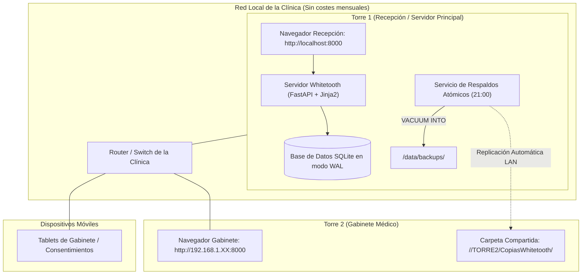

# 🦷 Whitetooth — Sistema Integral de Gestión para Clínicas Dentales

<p align="center">
  
  
  
  
  
</p>

---

## 📖 Descripción del Proyecto

**Whitetooth** es una solución de gestión odontológica y clínica desarrollada a medida para sustituir software propietario obsoleto (como *MN Program - Odontólogos*). Proporciona una interfaz web moderna, ultrarrápida e intuitiva que se ejecuta íntegramente de forma local en la clínica, **eliminando por completo las cuotas anuales de mantenimiento o licencias en la nube (0 €/año)**.

El sistema está diseñado específicamente para operar en un entorno de dos o más puestos en **Red Local (LAN)**:
- **Torre 1 (Recepción / Servidor)**: Ejecuta el motor FastAPI y almacena la base de datos SQLite en modo `WAL` (*Write-Ahead Logging*).
- **Torre 2 (Gabinete Médico / Doctores) y Tablets**: Acceden a través de cualquier navegador web estándar conectándose a la IP local de la Torre 1 (ej. `http://192.168.1.XX:8000`) sin necesidad de instalar bases de datos cliente ni correr riesgos de corrupción por compartir archivos `.db` en carpetas compartidas de Windows (SMB).

---

## 🏛️ Arquitectura de Red y Flujo de Trabajo



---

## ✨ Módulos y Funcionalidades Principales

### 1. 👥 Directorio y Ficha de Paciente Integral
- **Búsqueda instantánea (Ctrl+K)** por Nombre, Apellidos, DNI/NIE, Teléfono Móvil o Nº de Expediente.
- Filtros rápidos por estado de ficha (*Activos*, *Todos*) y pacientes con **Saldo Deudor**.
- **Panel clínico superior**: Resumen en tiempo real del saldo pendiente, total de tratamientos realizados, total cobrado y total presupuestado.
- **Alertas Médicas Destacadas**: Alergias medicamentosas (Penicilina, Látex, etc.) y antecedentes de riesgo visibles permanentemente para evitar incidencias en consulta.
- Registro legal inalterable de **Consentimiento RGPD / LOPD-GDD**.
- **Lanzador de WhatsApp**: Enlaces directos a `wa.me` sin coste para confirmación de citas, revisiones y recordatorios.

### 2. 🦷 Odontograma Interactivo SVG (FDI)
- Notación internacional **FDI**:
  - Dentición **Adulto**: Cuadrantes 1, 2, 3 y 4 (Piezas 11 a 48).
  - Dentición **Infantil / Temporal**: Cuadrantes 5, 6, 7 y 8 (Piezas 51 a 85).
- **Representación anatómica geométrica de 5 caras por pieza**: Vestibular (V), Lingual/Palatina (L), Mesial (M), Distal (D) y Oclusal/Incisal (O).
- Código visual de colores médico:
  - 🔵 **Azul**: Tratamiento previo / anterior (empastes antiguos, coronas preexistentes).
  - 🔴 **Rojo**: Tratamiento previsto / pendiente (caries detectada, endodoncia presupuestada).
  - 🟢 **Verde**: Tratamiento realizado en la clínica.
- Vinculación directa al catálogo de tratamientos y recálculo automático de honorarios y descuentos.
- Botón *"Marcar Realizado"* con 1 clic: traslada la actuación al historial clínico del paciente.

### 3. 📅 Agenda Multi-Gabinete
- Vista diaria en columnas simultáneas para **Despacho 1**, **Despacho 2** y **Despacho 3**.
- Intervalos de tiempo de **15 minutos** (de 08:00 a 20:30).
- Código de color personalizable por gabinete y doctor asignado.
- Estados de cita: *Programada*, *Confirmada*, *En Sala de Espera*, *En Consulta*, *Realizada*, *No Asiste* y *Cancelada*.
- Envío de recordatorio por WhatsApp a un clic con plantilla predefinida.

### 4. 📄 Presupuestos Clínicos con Aceptación en 1 Clic
- Creación de presupuestos con numeración secuencial anual correlativa (`#320/2026`).
- Adición de líneas de tratamiento vinculadas al catálogo con pieza dental, caras y descuentos aplicados.
- **Aceptación Automática**: Al pulsar *"Aceptar Presupuesto"*, todas las líneas presupuestadas se transfieren automáticamente como tratamientos activos previstos en el odontograma.
- Vista imprimible optimizada para entrega física al paciente con condiciones y pie de firmas.

### 5. 💰 Control de Cobros y Caja Diaria
- Libro diario de cobros con desglose por forma de pago: **Efectivo**, **Tarjeta (TPV)**, **Bizum**, **Transferencia** y **Financiación**.
- **Calculadora de Cambio**: Al registrar un cobro en efectivo, calcula al instante el cambio a devolver al paciente evitando errores de caja.
- Emisión opcional de Factura Oficial directa vinculada a la entrada de caja.

### 6. 🧾 Facturación Oficial y Facturas de Abono
- **Cumplimiento de la Ley Antifraude / Veri\*factu (RD 1007/2023)**:
  - Las facturas emitidas son inalterables y con numeración correlativa estricta (`OFICIAL #401/2026`).
  - Las correcciones o anulaciones se realizan mediante **Facturas de Abono (Rectificativas)** en serie `ABONO`, referenciando obligatoriamente el número de factura original y el motivo legal de rectificación.
- **Exención de IVA (0%)**: Regulada de conformidad con el **Art. 20.Uno.3º de la Ley 37/1992** del IVA (servicios sanitarios y estomatológicos).
- Vista de impresión fiscal lista para el paciente o gestoría.

### 7. 🛡️ Copias de Seguridad y Resiliencia en Red LAN
- Copias atómicas en caliente utilizando `VACUUM INTO` de SQLite: no bloquea ni detiene el trabajo de los gabinetes durante el respaldo.
- Programación automática diaria a las **21:00 hrs**.
- Duplicación automática en red local a la **Torre 2** (`//TORRE2/CopiasWhitetooth/`) para contingencias en caso de avería de hardware en la máquina principal.
- Botón *"Hacer Copia de Seguridad Ahora"* para respaldos manuales inmediatos y descarga de archivos `.db`.

---

## ⚙️ Estructura del Proyecto

```text
Whitetooth/
├── app/
│   ├── config.py             # Configuración general (rutas, puertos, clínica)
│   ├── database.py           # Esquema relacional SQLite (15 tablas) y semillas
│   ├── backup_service.py     # Motor de respaldos atómicos VACUUM INTO y red LAN
│   ├── main.py               # Aplicación FastAPI y rutas principales
│   ├── routers/
│   │   ├── pacientes.py      # Gestión de pacientes, historial y RGPD
│   │   ├── agenda.py         # Agenda diaria multi-gabinete (15 min)
│   │   ├── odontograma.py    # API REST del odontograma interactivo
│   │   ├── presupuestos.py   # Presupuestos y conversión a tratamientos
│   │   ├── cobros.py         # Libro de caja y calculadora de cambio
│   │   ├── facturacion.py    # Facturación oficial y facturas de abono
│   │   ├── whatsapp.py       # Generador de enlaces WhatsApp Web (0 €)
│   │   └── respaldos.py      # Panel de copias y estado de red local
│   └── templates/            # Plantillas Jinja2 con Tailwind CSS y Lucide Icons
│       ├── base.html
│       ├── index.html
│       ├── pacientes.html
│       ├── paciente_detalle.html
│       ├── agenda.html
│       ├── presupuestos.html
│       ├── presupuesto_detalle.html
│       ├── cobros.html
│       ├── facturas.html
│       ├── factura_detalle.html
│       └── respaldos.html
├── data/
│   ├── whitetooth.db         # Base de datos SQLite activa (WAL Mode)
│   └── backups/              # Almacén de copias de seguridad locales
├── iniciar_whitetooth.command# Lanzador de doble clic para macOS
├── run.py                    # Script de arranque con auto-detección y navegador
├── requirements.txt          # Dependencias de Python
└── README.md
```

---

## 🚀 Puesta en Marcha Rápida

### 1. Requisitos Previos
- Python 3.10 o superior (recomendado Python 3.14 o 3.12).
- Google Chrome, Safari, Firefox o Edge.

### 2. Instalación
Clonar el repositorio y preparar el entorno virtual:
```bash
git clone https://github.com/jess-jurado/Whitetooth.git
cd Whitetooth

# Crear entorno virtual
python3 -m venv venv

# Activar e instalar dependencias
source venv/bin/activate
pip install -r requirements.txt
```

### 3. Ejecución
Para iniciar el servidor y abrir la aplicación automáticamente en tu navegador:
```bash
python3 run.py
```
*`run.py` detectará automáticamente el entorno virtual, seleccionará un puerto libre (por defecto `8000` o `8001`) y abrirá tu navegador automáticamente.*

**En macOS**: También puedes hacer simplemente doble clic sobre el archivo **`iniciar_whitetooth.command`** desde Finder.

### 4. Conexión desde el Gabinete (Torre 2 o Tablets)
En la Torre 2 o tablets conectadas al WiFi de la clínica, abre el navegador e introduce la IP de la Torre 1:
```text
http://192.168.1.XX:8000
```
*(La IP exacta de tu red se muestra en la pantalla de la consola al arrancar el programa).*

---

## ⚖️ Cumplimiento Normativo y Legal en España

1. **Protección de Datos de Salud (RGPD / LOPD-GDD)**:
   - Registro con timestamp de la firma del consentimiento informado para el tratamiento de datos médicos de categoría especial.
2. **Ley Antifraude (Ley 11/2021 y RD 1007/2023 - Veri\*factu)**:
   - Registros de facturación inalterables con encadenamiento de registros.
   - Prohibición de eliminación o modificación de facturas; correcciones obligatorias mediante Facturas de Abono (Rectificativas).
3. **Exención de IVA en Tratamientos Sanitarios**:
   - Facturas expedidas al **0% de IVA** en estricto cumplimiento del **Artículo 20.Uno.3º de la Ley 37/1992**.

---

## 📄 Licencia

Este proyecto está bajo la Licencia **MIT**. Consulta el archivo `LICENSE` para más información.
